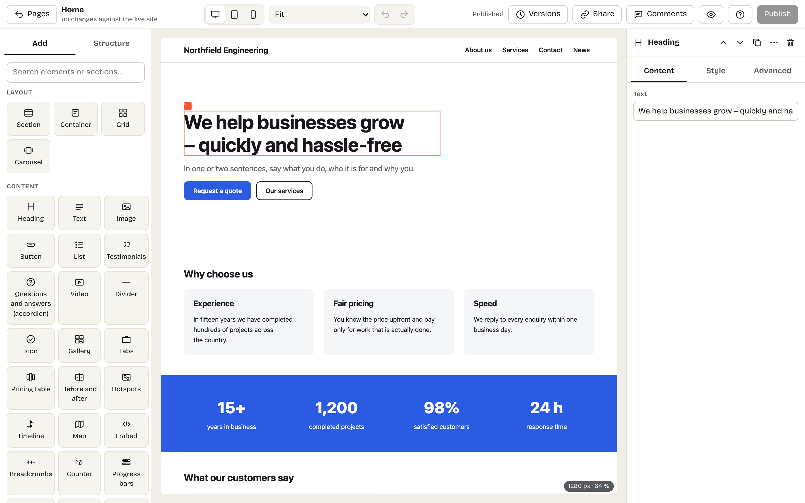

<p><picture><source media="(prefers-color-scheme: dark)" srcset="image/talea-logo-dark.svg"></picture></p>

# Talea

**A self-hosted website builder for small businesses and freelancers** – "a self-hosted Squarespace": pages, news,
a visual page builder whose output reads like hand-written HTML, forms and enquiries, an AI assistant, Claude over MCP,
and a WordPress importer. You own the site, the data and the server.

> **Talea is a hard fork of [Kaleta](https://kaletacms.com)**, the open-source CMS by Miroslav Kaleta
> ([@phprscms](https://github.com/phprscms)) and contributors – source at
> [phprs-cms/kaletacms](https://github.com/phprs-cms/kaletacms). The page builder, the design system, MCP, the WordPress
> importer and nearly everything under [Features](#features) are their work. Talea branched off at Kaleta 3.7.0 in
> October 2026, keeps the whole history and goes its own way since: [What Talea changes](#what-talea-changes).
> Looking for FTP hosting with updates installed from the admin? Use Kaleta.



## Features

All of these come from Kaleta; Talea keeps and maintains them.

- **Page builder** – the canvas is the real page. Drag elements and ready-made sections into place, style them separately
  for desktop, tablet, mobile and hover. Drafts save continuously and go live only when you publish; older versions can be restored.
- **Library of 40 ready-made sections** (heroes, services, pricing, testimonials, team, gallery, contact with a form…) and
  **three starter sites** at installation. Texts follow the page language.
- **Design system** – one-click styles, colours with a readability (WCAG) check, dark mode, fonts, fluid sizes and spacing –
  all tokens, so changing a colour restyles the whole site.
- **Site parts** – header, footer and wrappers for the news item, news list and 404 page in the builder, including
  variants for selected pages (a landing page without navigation).
- **Pop-ups** – windows, slide-in panels and bars built in the builder, with triggers (time, scrolling, exit intent,
  idle time, page count), rules by page, language, period, device and campaign, and cookie-free views and conversions.
- **Components** – reusable blocks with properties; editing a component updates it everywhere.
- **Collections** – custom content types (testimonials, team, products, branches…) with their own fields, listed in the
  builder with `{{field}}` tags, filters, sorting and pagination, and item pages with a builder template.
- **Forms and enquiries** – an enquiry form without CAPTCHA or cookies, enquiries in the admin, email notifications,
  CSV export and automatic deletion of personal data.
- **Newsletter** – double opt-in sign-up; send your latest news in an e-mail styled by the design system (through SMTP),
  or pass confirmed subscribers to Brevo, MailerLite, Mailchimp, Ecomail, SmartEmailing or any service via a webhook.
- **Company details** – address, company ID, opening hours and map once in Settings; the site shows them and search
  engines get LocalBusiness structured data.
- **AI** – the assistant drafts a new section from a description, rewrites element text, suggests headlines, SEO
  descriptions, proofreading and translation (Claude, OpenAI, Google Gemini or Mistral). Claude can also build the site
  over **MCP**: it turns HTML into builder content and edits site parts, collections and the design – always as a draft to approve.
- **News** (blog), sites in around forty languages, SEO and llms.txt, cookie-free analytics, redirects, backups,
  **WordPress import** (straight into the builder, too).

## What Talea changes

Kaleta is a CMS for business websites that installs over FTP and updates itself. Talea aims at a self-hosted Squarespace
alternative for small businesses and freelancers, runs as a container and adds the pieces that goal needs. The reasoning
behind each decision is in [docs/DECISIONS.md](docs/DECISIONS.md).

### The foundation

| | Kaleta | Talea |
|---|---|---|
| Installation | ZIP upload to PHP hosting, then `install.php` | Docker-first: a container image (FrankenPHP), configuration from environment variables, one install per site |
| Updates | The site downloads and installs signed packages from the admin | In-app updater switched off; an update is a new image. The admin only shows a notice from a signed release feed |
| PHP | 8.3+ | 8.5+ |
| Database | MySQL 8 / MariaDB 10.6+ | MySQL 8 or PostgreSQL 18 – the same code on both, through a small dialect layer |
| Schema | `schema.sql` | Phinx migrations, applied by `bin/migrate` (installer, container start, tests), never on a page request |
| Names in code | Czech names in code, tables, routes and stored values | English everywhere; Czech is one of the translations |
| Ids at the boundary | Integer row ids | UUID v4 `public_id` in admin URLs, MCP, previews, webhooks and exports |
| Tests | Shell walk (`tools/test.sh`) and a check harness | PHPUnit and ParaTest (unit, integration, whole installed sites), a browser walk, both database engines. Composer is used for these tools only |

### Added in Talea

- **Looks gallery** – 14 finished looks (design system, header and footer, recommended sections), each tried on the real
  site before it is applied. Kaleta deliberately had no style presets.
- **Font library** – about 28 open-source families, mirrored and self-hosted (see [docs/FONTS.md](docs/FONTS.md)).
- **Visual composing on the canvas** – spacing, size and column dividers dragged directly on the page, and a *Compose*
  section with a 12-column grid and layers ([docs/specs/visual-compose.md](docs/specs/visual-compose.md)).
- **Onboarding** – three first-run questions (topic, features, how to start) that lead to the looks or to the AI wizard.
- **AI inside the admin** – a first-run wizard and an *Ask* box in the builder, with the owner's own key; drafts only,
  every run can be undone.
- **A/B tests** – variants of pages, sections or elements with goals and a "promote winner" step.
- **Member login** – visitor accounts with e-mailed links, groups, and pages, collection items and news restricted to them.
- **Structured data element** – schema.org markup in the builder, checked before publishing.
- **Add-on API v2** with three bundled add-ons, off by default: domain watch, firewall, client galleries.

### Removed or switched off

- Whistleblowing is removed.
- The in-app updater is off (see above).
- The firewall's blocklists, country and network blocks moved from the core into an add-on.
- The notice board is off by default (offered for the municipality blueprint only).

### Kaleta changes after the fork

Talea merges nothing from upstream. Changes in Kaleta after 3.7.0 are read, filed as issues and re-implemented in Talea's
style (English names, migrations, public ids, portable SQL). Ported so far, through Kaleta 3.11.0: shared addresses per
language, WordPress multilingual import, Arabic and right-to-left pages, regional language versions, the MCP Essentials tool
set, placeholders instead of invented sample content, drafts by default, a server clock check and security fixes. The ideas
behind them are Kaleta's.

## Principles

The first five are Kaleta's and stay; the last one is Talea's.

- **Simple code:** plain PHP, no framework, no ORM, no build step; no third-party plugins.
- **Clean output:** one builder element = one HTML tag, CSS only for what the page uses, in cascade layers (`@layer`);
  JavaScript only where it is really needed. Tests enforce it.
- **Web 2026:** fluid type and spacing, container queries, OKLCH colours (`color-mix`), the Popover API, view transitions.
- **AI as a first-class user:** whatever works in the editor works over MCP – same schema, validation and permissions.
- **Privacy and accessibility by default:** no third-party scripts or fonts, colour contrast checks.
- **One container per site:** configuration in the environment, updates by image, migrations before the site starts.

## Quick start (Docker)

```bash
# set TALEA_DB_PASSWORD and TALEA_SITE_URL in docker-compose.yaml (or in your environment)
docker compose up -d --build   # then open http://localhost:8080: the installer asks for the site and the administrator
```

The stack is Talea on FrankenPHP plus MySQL 8.4; configuration comes from environment variables, updates are a new image
(the entrypoint applies pending migrations). All variables and volumes: [docker/README.md](docker/README.md).
Other ways to run it (hosting, reverse proxy, backups): [docs/DEPLOYMENT.md](docs/DEPLOYMENT.md).

## Development

```bash
export DEV_UID=$(id -u) DEV_GID=$(id -g)
docker compose -f docker-compose-dev.yaml up -d --build   # code mounted from the checkout, mail catcher, Adminer
composer test                                             # PHPUnit: unit, integration against MySQL, whole installed sites
```

`php tools/unit-tests.php` runs the fast checks, `php tools/contracts.php` shows changes of the public contracts (MCP tools,
design tokens, builder elements), static analysis is PHPStan. How to contribute: [CONTRIBUTING.md](CONTRIBUTING.md);
architecture notes for contributors and agents: [CLAUDE.md](CLAUDE.md).

## Documentation

- [User manual](docs/manual.md)
- [Deployment](docs/DEPLOYMENT.md)
- [Releasing](docs/RELEASING.md) and [release policy](docs/RELEASE-POLICY.md)
- [Writing add-ons](docs/EXTENSIONS.md)
- [Where Talea differs from Kaleta](docs/DECISIONS.md)
- [Kaleta's roadmap up to the fork](docs/ROADMAP.md) (history)
- Kaleta itself: [kaletacms.com](https://kaletacms.com) · [guide](https://kaletacms.com/guide) ·
  [phprs-cms/kaletacms](https://github.com/phprs-cms/kaletacms)

## Licence and credits

GNU GPL version 2 or later; the licence text is in [`LICENSE`](LICENSE).

Talea is built on Kaleta by Miroslav Kaleta and the Kaleta contributors, whose commits are kept in this repository's
history. The attribution and the copyright of both projects are in [`NOTICE`](NOTICE). If Talea is useful to you, consider
supporting the original project as well: [Kaleta on GitHub](https://github.com/phprs-cms/kaletacms).
